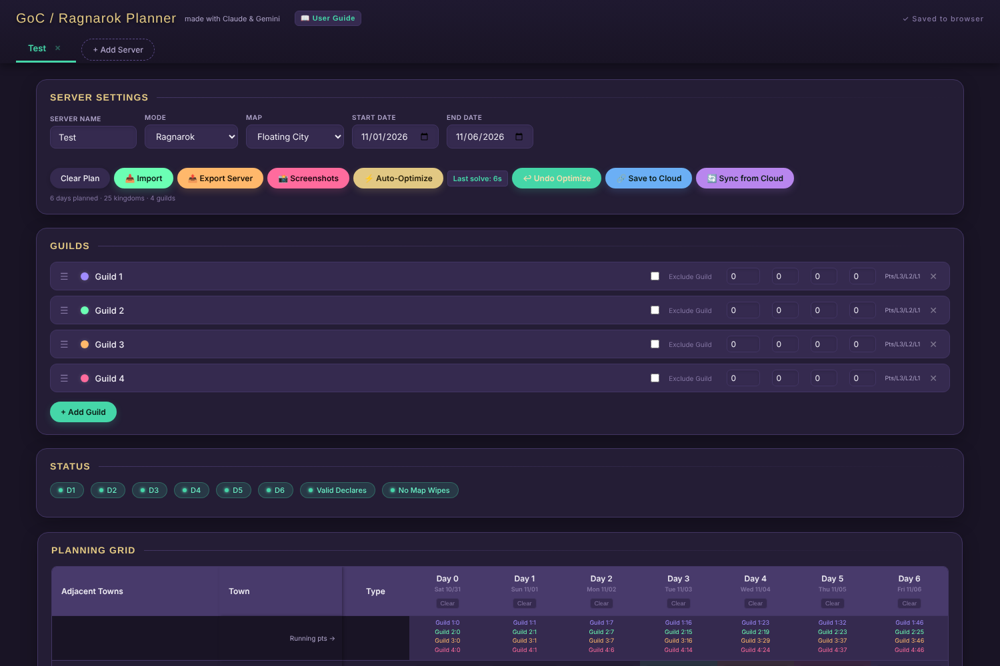

# GoC / Ragnarok Planner

[](https://goc-rag-planner.pages.dev/)
[](https://github.com/arisim67/GoC-RAG-Planner/actions/workflows/ci.yml)
[](LICENSE)
[](https://prettier.io)

A browser-based planning tool for **Tokyo Debunker** guild events: **Game of Claws (GoC)** and **Ragnarok**.
Server leads use it to lay out who takes which town on which day, check that the plan is legal,
and auto-balance points, Darkwick and dorm time across guilds with a built-in MILP optimizer.

**[Open the app](https://goc-rag-planner.pages.dev/)** · **[User guide](docs/user-guide.md)** · [Changelog](CHANGELOG.md) · [Privacy](PRIVACY.md)



## Features
 
- **Planning grid** for every town and day, with adjacency shown inline and drag-to-copy across days
- **Live validation** of adjacency, daily declare limits (2 for GoC, 3 for Ragnarok) and map wipes
- **Auto-Optimize**: proposes a full, legal plan that balances final points, Darkwick and dorm counts
- **Import / export**: paste guild lists or daily placements; back up a whole server as JSON
- **Save to Cloud**: share a live link with server leadership
- **Screenshots and daily messages** ready to paste into Discord
- **Interactive tutorial** on first visit, replayable from the Tutorial button
- Runs entirely in the browser and saves automatically to local storage

## Running locally
 
There is no build step. The app uses ES modules and a Web Worker, so it must be served over HTTP;
opening `index.html` directly from disk will not work.
 
```bash
git clone https://github.com/arisim67/GoC-RAG-Planner.git
cd GoC-RAG-Planner
python3 -m http.server 8000
# then open http://localhost:8000
```
 
Any static file server works (`npx serve`, the VS Code Live Server extension, etc.).

## Development

Tests and formatting need [Node.js](https://nodejs.org) 20 or newer. There are no dependencies to install.

```bash
npm test               # run the tests in tests/
npm run format         # format the code with Prettier
npm run format:check   # what CI runs: fails if anything isn't formatted
```

GitHub Actions runs the tests and the format check on every push (see the badge above).

Commit messages are short and say what changed, in the imperative:
`Fix guild alignment in Declares table`, `Add message templates`. Notable changes also get a line in
[CHANGELOG.md](CHANGELOG.md) under the date they go live.
 
## Project structure
 
```
├── index.html              App page
├── css/                    Styles, one file per part of the page:
│   ├── base.css            Colors, fonts, layout, buttons and form fields
│   ├── header.css          Header, server tabs, jump bar, footer
│   ├── setup.css           Server settings, toolbar, guild list
│   ├── tables.css          Planning grid, scores and stats tables
│   ├── messages.css        Daily messages and the template editor
│   ├── dialogs.css         Dialogs, toasts and the "We've moved" banner
│   ├── responsive.css      Phone layout and screenshot mode (loaded last)
│   └── tour.css            Interactive tutorial
├── js/
│   ├── app.js              Entry point: startup, and what each button and field does
│   ├── actions.js          Connects buttons and fields to their functions (data-action etc.)
│   ├── state.js            Servers, active server, guild colors, saving/loading
│   ├── calc.js             Scores, occupation, declares, plan validation
│   ├── render.js           Builds the page (tabs, settings, guilds, grid, stats, messages)
│   ├── messages.js         Daily messages and the message template editor
│   ├── icons.js            Line icons used on buttons (from Lucide)
│   ├── color-picker.js     The guild color pop-up (Palette and Custom tabs)
│   ├── history.js          Undo and redo for changes to the plan
│   ├── versions.js         Version history: saved copies of each server, and restoring them
│   ├── spotlight.js        Guild spotlight: highlight one guild's towns
│   ├── collapse.js         Folding sections down to their titles
│   ├── status-jump.js      Status pills that jump to the problem
│   ├── solve-panel.js      The panel shown while Auto-Optimize runs
│   ├── map-view.js         The Map view: the event map for one day
│   ├── whats-new.js        The one-time What's new card for returning visitors
│   ├── discord-md.js       Shows message text the way Discord displays it (template preview)
│   ├── handlers.js         Edits made in the page (settings, guilds, grid cells)
│   ├── servers.js          Server tabs: add, switch, rename, duplicate, delete
│   ├── import-export.js    Import modal and Export Server
│   ├── optimize.js         Auto-Optimize (runs the solver in a Web Worker)
│   ├── grid-fill.js        Select cells and drag to copy across days
│   ├── grid-keys.js        Editing the Planning Grid from the keyboard
│   ├── screenshots.js      Screenshots
│   ├── cloud.js            Save to Cloud / Sync and shared plan links
│   ├── preview.js          Draws the link-preview image for a shared plan
│   ├── ui.js               Small helpers (toasts, escaping, date labels)
│   ├── config.js           Deployment settings (cloud sync URL)
│   ├── tour.js             Interactive first-visit tutorial
│   ├── maps/               Towns and roads for each map; layouts.js, roads.js and art.js place them for the Map view
│   └── solver/
│       ├── worker.js       Runs HiGHS in a Web Worker so the page stays responsive
│       ├── milp.js         Small helper for building MILP models
│       ├── model_ragnarok.js   Ragnarok model (single solve)
│       ├── model_goc.js    Game of Claws model
│       ├── twophase.js     GoC two-phase strategy (Darkwick/dorms, then points)
│       ├── paths.js        Works out the Lv1 towns needed to reach Darkwick/dorms
│       └── check.js        Plain-JS legality check for solver output
├── functions/index.js      Cloudflare Pages only: gives shared plan links their own preview
├── _routes.json            Cloudflare Pages only: runs that function for the main page only
├── cloud-worker/           Runs on Cloudflare, not in the browser (deployed separately)
│   └── worker.js           Stores shared plans and serves share links with their previews
├── tests/                  Automated tests (node --test), with example plans in tests/fixtures/
├── .github/                CI workflow and issue templates
├── vendor/highs/           Vendored HiGHS solver (WebAssembly)
├── images/                 Favicons, and map/ with the building and town pictures for the Map view
└── docs/                   User guide and screenshots
```

At the root you'll also find `README.md`, `CHANGELOG.md`, `PRIVACY.md`, `LICENSE`, and `package.json`
(scripts for tests and formatting; the app itself has no build step or dependencies).

## How the optimizer works

Plans are written as mixed-integer linear programs and solved in the browser with
[HiGHS](https://highs.dev) compiled to WebAssembly.

- **Ragnarok** is solved in a single pass (up to about a minute).
- **Game of Claws** is larger, so it is split in two, the way it is done by hand. Phase 1 shares out
  Darkwick and the dorms a few days at a time with lookahead, and fixes the Lv1 "path" towns each
  guild needs to reach them. Phase 2 hands out the remaining Lv1 towns in one solve to even out total
  points. Every result is re-checked by `check.js` before it replaces a legal plan. A full run takes
  around 5–15 minutes.

The optimizer gives a strong starting point, not a guaranteed-perfect plan. Check the Stats table and
adjust by hand where needed.

## Credits

Made by **ari** (EA-4, 43, 45)/**gharial** (EA-44), with help from Claude and Gemini.
Questions or suggestions: `arianes.` on Discord.

Solver: [HiGHS](https://highs.dev) via [highs-js](https://github.com/lovasoa/highs-js) (MIT).
Libraries: [JSZip](https://stuk.github.io/jszip/), [html2canvas](https://html2canvas.hertzen.com/),
[SortableJS](https://sortablejs.github.io/Sortable/). Icons: [Lucide](https://lucide.dev) (ISC).

## License

Code is released under the [MIT License](LICENSE).

This is a fan-made tool and is not affiliated with or endorsed by the developers or publishers of
Tokyo Debunker. Game names and terms belong to their respective owners. The map artwork, buildings and
characters in `images/map/` are official Tokyo Debunker artwork and belong to its creators; they are used
here only to show the in-game maps.
