# GoC / Ragnarok Planner: User Guide

The GoC / Ragnarok Planner, made by ari (EA-4, 43, 45) and gharial (EA-44), helps Tokyo Debunker guilds plan Game of Claws (GoC) and Ragnarok together: who holds which town on which day, with every move legal and the points shared out evenly.

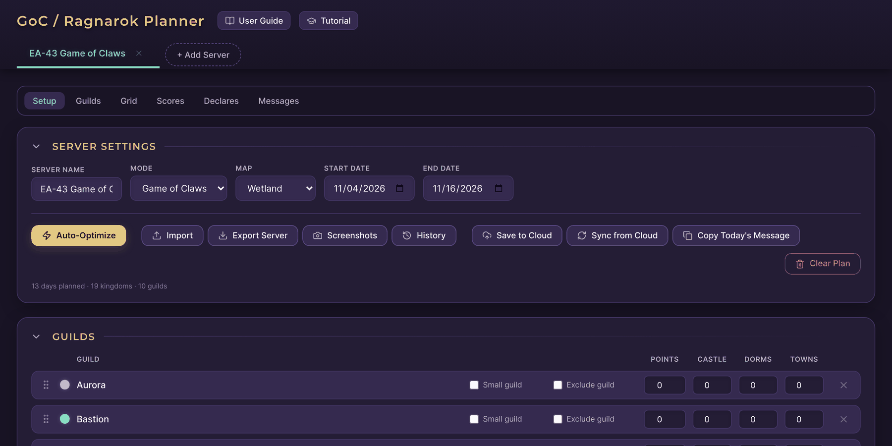

**New here?** The first time you open the app, a short interactive tutorial walks you through it. You can skip it, and replay it any time with the **Tutorial** button at the top of the page.

## Contents

- [Quick start](#quick-start)
- [Getting around](#getting-around)
- [Servers](#servers)
- [Guilds](#guilds)
- [The planning grid](#the-planning-grid)
- [Auto-Optimize](#auto-optimize)
- [Checking the plan](#checking-the-plan)
- [Scores and tables](#scores-and-tables)
- [Sharing the plan](#sharing-the-plan)
- [Daily messages](#daily-messages)
- [Saving, backups and support](#saving-backups-and-support)

## Quick start

1. **Add a server.** Click **+ Add Server** and fill in the server name, mode, map and event dates. The mode sets the declare limits and which maps you can pick.
2. **Add your guilds.** Type their names in the Guilds list, or click **Import** and paste the whole list.
3. **Plan the grid.** Pick who holds each town on each day, starting with Day 0, or click **Auto-Optimize** to have the planner work it out.
4. **Check it.** Every pill under **Status** should be green. A red one takes you straight to the problem.
5. **Share it.** **Save to Cloud** copies a link for your leads, and each day's message is one click to copy for Discord.

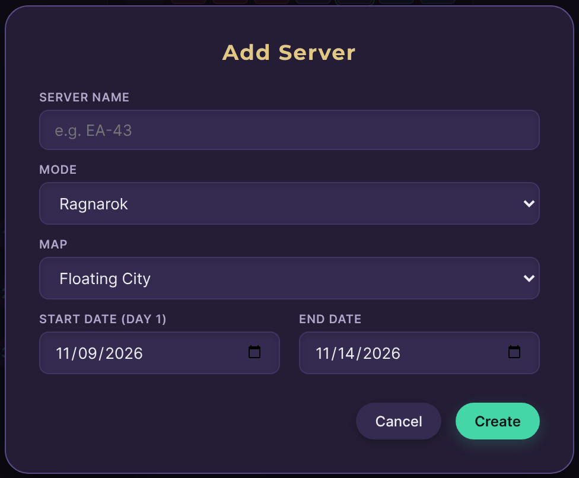

## Getting around

- **Section links:** the bar of links at the top (Setup, Guilds, Grid, Scores, Declares, Messages) stays on screen as you scroll and jumps to each part of the page.
- **Folding sections:** click a section's title, or the arrow beside it, to fold it down to just the title, and again to open it. Hide what you don't need, such as the Guilds list once it's set up. Folded sections are remembered in this browser for every server, open when you jump to them, and are still included in Screenshots.
- **Server tabs:** each server you plan has its own tab along the top. Right-click a tab (or press and hold on a phone) to rename, duplicate or delete it.

## Servers

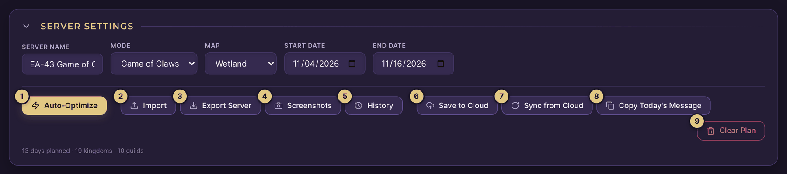

The settings at the top hold the server's name, mode, map and event dates. The toolbar under them:

1. **Auto-Optimize:** works out a whole plan for you. See [Auto-Optimize](#auto-optimize).
2. **Import:** paste a guild list or a day's town owners, or load a server backup file.
3. **Export Server:** downloads a backup of this server as a `.json` file.
4. **Screenshots:** saves images of the grid and tables to share in Discord.
5. **History:** saved copies of this server that you can go back to. See [Saving, backups and support](#saving-backups-and-support).
6. **Save to Cloud:** saves the plan online and copies a link to share. See [Sharing the plan](#sharing-the-plan).
7. **Sync from Cloud:** brings back the version saved online.
8. **Copy Today's Message:** copies today's daily message. It only appears while the event is running.
9. **Clear Plan:** empties every day of the grid. A copy is kept in History first, and **Undo** brings it back.

**Deleting a server** asks you to confirm first. A copy is kept in **History**, so a server deleted by mistake can be brought back.

## Guilds

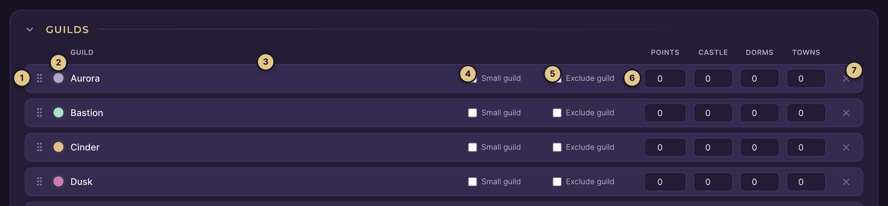

1. **Drag handle:** press and hold, then drag to reorder the guilds. The order decides which guilds get extra points, dorm time or castle time when things can't be split evenly.
2. **Color:** click the dot to choose the guild's color. The **Palette** tab has colors that suit the planner and read well on its dark background (a small dark dot marks colors another guild already uses). The **Custom** tab takes any color, from the color chooser or as a hex code like `#45d6a8`. You'll get a warning if a color is very close to another guild's, or too dark to read easily.
3. **Name:** type the guild's name. To set up every name at once, click **Import**, choose **Import Guild List (Setup)** and paste the names, one per line.
4. **Small guild:** for a guild that has trouble staying in the top 8 for kudos. It limits the guild to 1 declare a day.
5. **Exclude guild (Ragnarok only):** keeps the guild's Day 0 towns on the map but leaves it out of declares and point balancing, so the plan is built around it without giving it anything.
6. **Points, Castle, Dorms, Towns:** when you start a plan partway through an event, enter each guild's current points and how many days it has already held the castle, dorms and towns. Auto-Optimize uses these to keep the rotation fair across the whole event.
7. **Remove** the guild.
8. **Add Guild:** a server holds up to **15 guilds**, and each new one gets a color no other guild is using.

## The planning grid

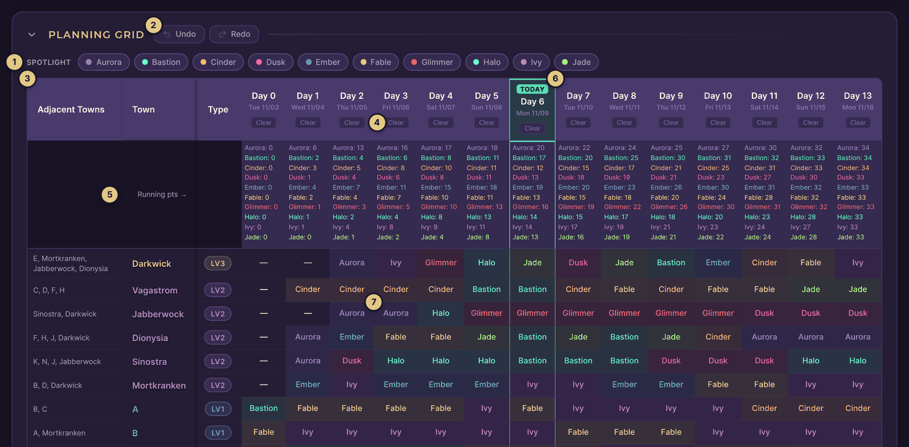

One row per town, one column per day.

1. **Spotlight:** click a guild to see only its towns (more below).
2. **Undo and Redo** (more below).
3. **Adjacent Towns:** the towns next to each one, so you can see what connects without a map.
4. **Clear:** empties that day.
5. **Running points:** every guild's total so far, day by day.
6. **Today:** while the event is running, today's column is highlighted (more below).
7. **A cell:** click it and pick the guild that holds the town that day. Start with each guild's footholds on **Day 0**. A long guild name wraps onto a second line rather than being cut off.

### Copying across the grid

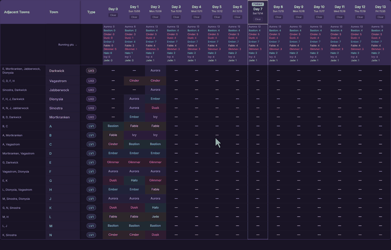

The grid copies like a spreadsheet:

- **Select cells** in any of three ways: press and hold one cell, press and drag across a block, or click one cell and shift-click another. A quick click opens the cell's list instead, so selecting never gets in the way.
- **Drag the handle** on the selected block's bottom-right corner sideways to repeat the block across days, or down to repeat it down towns.
- The block **repeats rather than stretches**: dragging a two-day pattern across six days lays it down three times.

### Keyboard editing

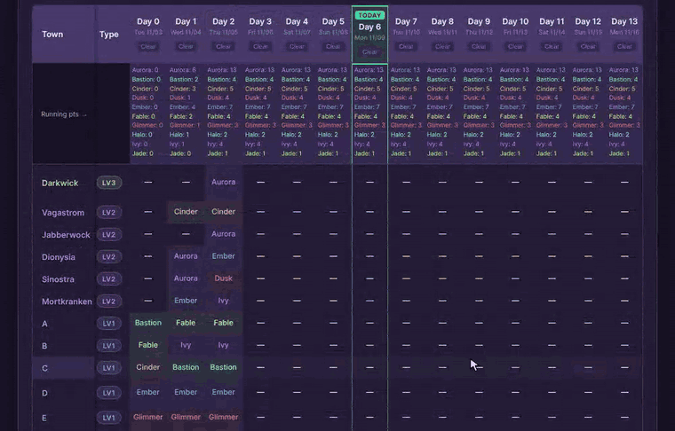

Click a cell (or Tab into the grid) and use the keyboard like a spreadsheet:

| Keys | What they do |
|---|---|
| Arrow keys | Move between cells |
| Home / End | Jump to the first or last day |
| Shift + Arrow | Select a block |
| Type the start of a name | Put that guild in the cell. Type the same letter again to step through guilds starting with it |
| Enter, Space or F2 | Open the cell's full list |
| Delete or Backspace | Empty the selected cells |
| Ctrl+C / Ctrl+X / Ctrl+V | Copy, cut and paste (⌘ on a Mac) |
| Ctrl+A | Select the whole grid |
| Escape | Leave the grid |

Pasting into a bigger selection repeats the block across it, like dragging the handle. Copied cells also paste into another server (guilds are matched by name), or into a spreadsheet as guild names.

### Guild spotlight

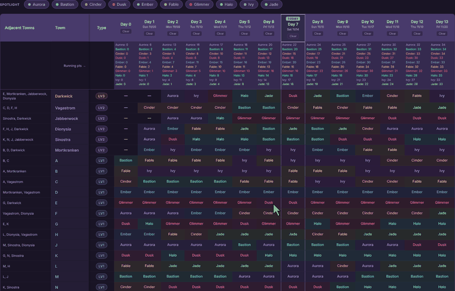

Click a guild under **Spotlight** above the grid (or its card under Final Scores) to outline its towns on every day and fade everything else, in the grid, the Declares & Giveaways table and the score cards. A line shows the guild's final points and how many days it holds the castle, dorms and towns. Click it again, or press Escape, to go back to the full view.

It works on view-only shared plans too, so guild members can check their own route from the link. Screenshots always show the full view.

### Today

While an event is running, today's column is highlighted in the grid and the Declares & Giveaways table, and the grid opens scrolled to it. Today's daily message card is highlighted too, and **Copy Today's Message** in the toolbar copies it without scrolling down.

"Today" follows the game's day, which changes at 1 am Eastern Standard Time (06:00 UTC), so everyone sees the same day wherever they are.

### Undo and Redo

**Undo** and **Redo** above the grid (or Ctrl+Z and Ctrl+Y; ⌘Z and ⌘⇧Z on a Mac) step back and forward through changes to the plan: picking a guild in a cell, copying across cells, Clear Day, Clear Plan, importing a day, removing a guild and Auto-Optimize. Hover a button to see which change it will undo.

The last 50 changes are kept while the page is open. Changing the mode or map, or importing a whole server or a new guild list, starts afresh.

### Importing a day

Click **Import**, choose **Import Daily Map Data**, pick the target day, and paste the guilds in the same order as the towns in the grid, one per line.

## Auto-Optimize

**Auto-Optimize** works out a route that follows every adjacency rule, never wipes a guild off the map, and evens out final scores and time on Darkwick and the dorms.

- **Ragnarok:** the route is found in one pass, which can take up to about a minute.
- **Game of Claws:** around **1 to 3 minutes for 10 guilds**, and up to about **10 minutes for 13**. A message appears when you start.
- **Speed it up:** filling in a day or two yourself first makes a real difference, because those are days the optimizer no longer has to work out.
- **Keep the page open** until it finishes. The button shows how long it has been running. Keeping the tab visible is best, since browsers can slow down background tabs, and phones may stop the work if the screen locks.
- **Not happy with the result?** **Undo** puts the plan back exactly as it was, and **Redo** brings the optimized plan back. This still works after reloading the page, as long as you haven't changed the plan since.

How it works, and its limits

For Game of Claws the plan is built in two steps. First, Darkwick and the dorms are shared out as evenly as possible, and the app adds the Lv1 towns each guild needs to hold to reach them. Then the remaining Lv1 towns are handed out to even out total points. How long this takes depends mostly on the number of guilds. On a 10-guild map, planning day 2 by hand as well as day 1 cut a run from about three and a half minutes to one.

The optimizer is still being improved and won't always produce a perfect split. Treat it as a strong starting point rather than a finished plan. For Game of Claws, even Darkwick and dorm counts come first, so a few guilds can end up a point or two away from an even total. Check Final Scores and adjust by hand if needed.

## Checking the plan

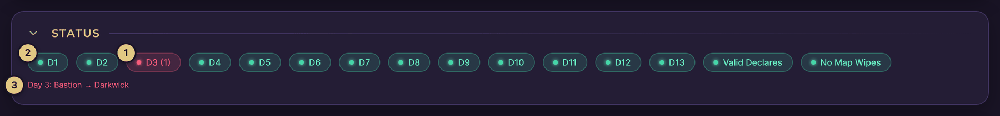

The app checks your plan as you go, to make sure it can actually be played out in-game. Look at **Status** above the planning grid:

1. **A red pill** means a rule is broken. Click it to jump straight to the problem: a day's pill shows that day's problem cells in the grid, **Valid Declares** shows the guilds declaring too many towns, and **No Map Wipes** shows the day a guild is wiped. What it jumps to flashes so it's easy to spot, and a folded section opens.
2. **A green pill** means that day (or rule) is fine.
3. **Each problem** is listed under the pills. Click one to go to it.

The rules it checks:

- **Adjacency:** a guild can only take a town next to one it holds. A cell that breaks this has a red-striped background.
- **Declare limits:** 2 declares a day in Game of Claws, 3 in Ragnarok, and 1 for a small guild.
- **Map wipes:** a guild must never lose all its towns.

## Scores and tables

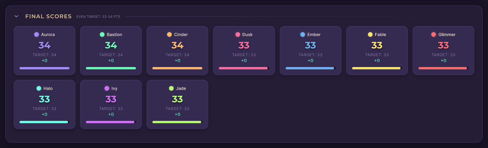

- **Final Scores** shows each guild's points next to the even target, so you can see at a glance who is over or under.
- **Total Occupation** counts the days each guild held Darkwick, a dorm and a Lv1 town. Check it when points are even but castle or dorm time is not.

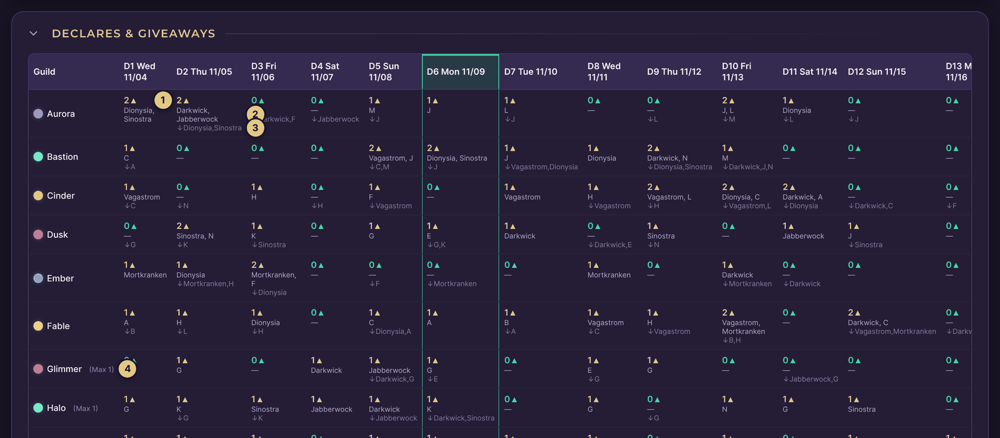

The **Declares & Giveaways** table shows what each guild does each day:

1. **▲ Declares:** how many towns the guild declares on that day.
2. **The towns** it declares on.
3. **↓ Giveaways:** the towns it gives away that day.
4. **(Max 1):** marks a small guild, which can only declare once a day.

## Sharing the plan

- **Save to Cloud** saves the plan online and copies a link. Anyone who opens the link sees your plan as a view-only copy. When you make changes, click **Save to Cloud** again; the people you shared it with click **Pull Latest Updates** (or reload the page) to get your new version.
- **Sync from Cloud** brings the saved online version of this server back to this browser, which is useful when you've been editing from another device. It **replaces** this browser's copy, so anything changed here since the last Save to Cloud is lost. Save first if you're not sure which side is newer.
- **Screenshots** saves unclipped, high-resolution images of the grid and the score and declares tables, bundled in a `.zip` file for sharing on Discord. On phones and tablets, **Share to Apps** sends them straight to Discord or any other app.

### What the people you share with see

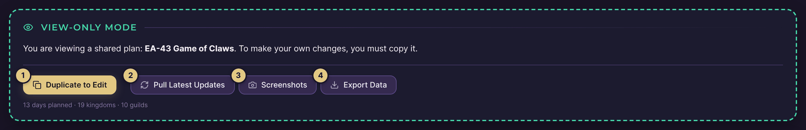

A shared link opens a locked copy that can't be edited, with four buttons:

1. **Duplicate to Edit** makes an editable copy in a new tab, called "… (My Copy)". It's a separate plan from then on and doesn't receive your later updates.
2. **Pull Latest Updates** fetches your newest saved version.
3. **Screenshots** saves the images.
4. **Export Data** downloads the plan as a `.json` backup.

### Link previews

When you post a Save to Cloud link in Discord (or anywhere else that expands links), it unfolds into a card showing the plan itself: your server's name, the mode, map, dates and guild count, and a scoreboard of every guild's final score and days holding towns, dorms and the castle.

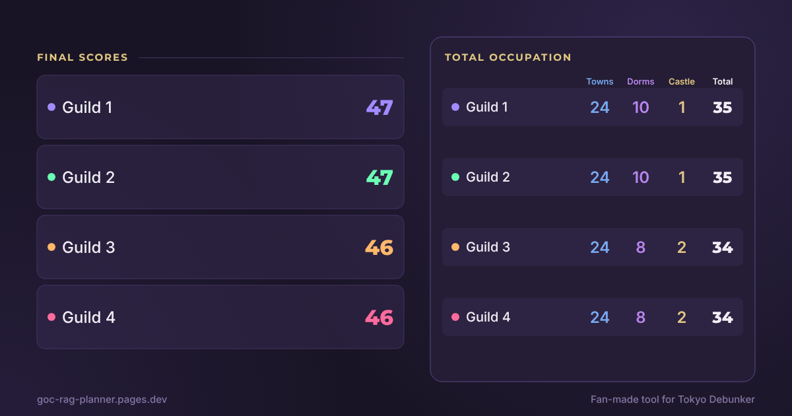

More about link previews

- The image is drawn when you click **Save to Cloud** and uploaded with the plan, so it always matches the version you last saved. Save again after editing and the card updates too.
- The card shows **only** scores and occupation, never the day-by-day grid, so posting a link doesn't give away your route before the event.
- Discord and most apps keep a link's preview for a while. If you save changes and the old card still shows, that's the app's cache, not a failure. The link itself always opens the current plan.
- If the preview can't be built for any reason, the plan still saves and the link still works; you get the site's standard card instead.

## Daily messages

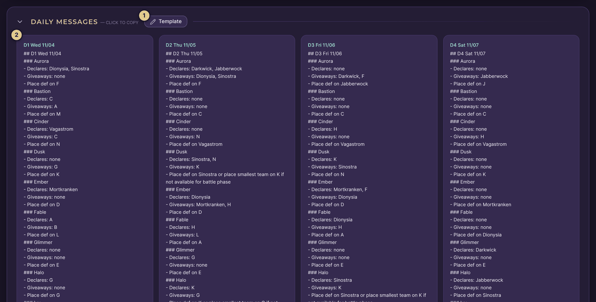

The planner writes each day's instructions for every guild: what to declare, what to give away and where to place def.

1. **Template:** change how the messages are written (below).
2. **A day's card:** click it to copy that day's message, then paste it into Discord.

### Message template

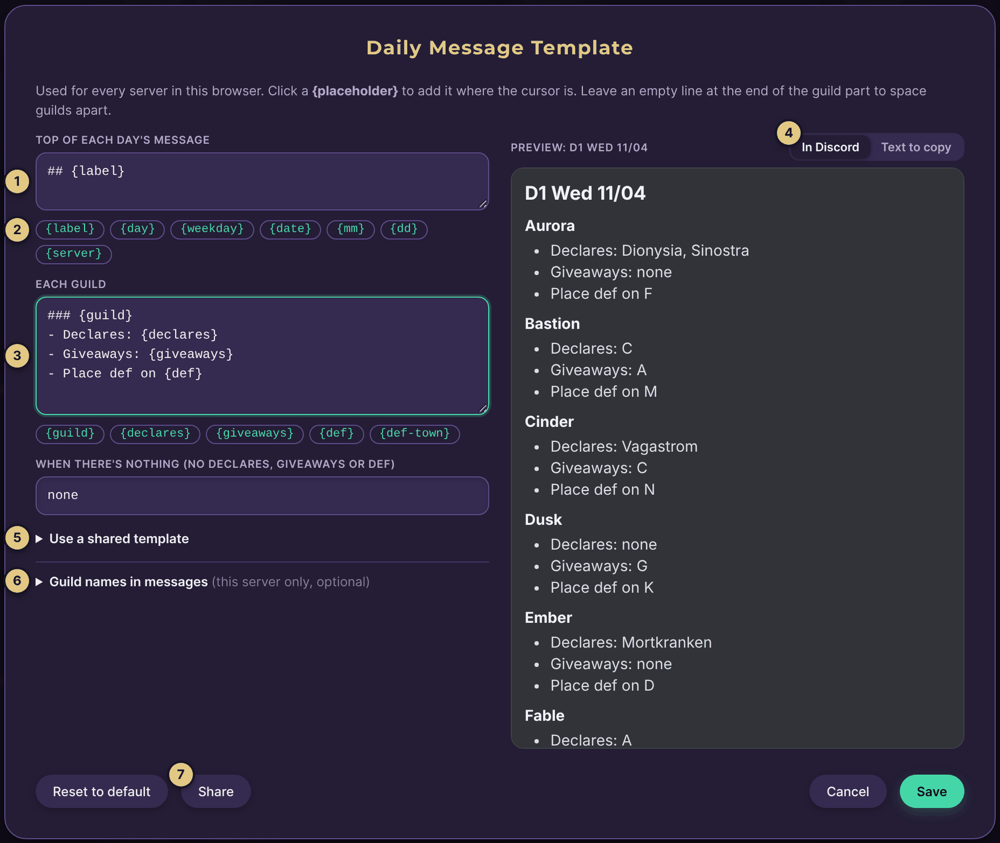

1. **Top of each day's message**, written once per day.
2. **Placeholders:** click one to add it where the cursor is. The planner fills them in.
3. **Each guild:** the part repeated for every guild.
4. **Preview:** **In Discord** shows how the message will look once posted (headings, bold, lists and so on), and **Text to copy** shows the exact text.
5. **Use a shared template:** paste a template link someone shared.
6. **Guild names in messages:** give any guild a decorated name (emoji and all) used in messages only. Tables keep the plain name. These are saved with the server, so they come along with Export and Save to Cloud.
7. **Share:** copies a link to your template for other planners.

The template is saved in your browser and used for every server. **Reset to default** brings back the original format. You can also choose what to show when a guild has nothing to do, such as `--`.

Every placeholder

| Placeholder | Becomes |
|---|---|
| `{label}` | Day, weekday and date, e.g. D5 Sun 11/08 |
| `{day}` | Day number, e.g. D5 |
| `{weekday}` | Weekday, e.g. Sun |
| `{date}` | Date, e.g. 11/08 |
| `{mm}` / `{dd}` | Month / day of the month |
| `{server}` | The server's name |
| `{guild}` | The guild (its name in messages, if it has one) |
| `{declares}` | Towns declared |
| `{giveaways}` | Towns given away |
| `{def}` | Where to place def, with the backup advice |
| `{def-town}` | Where to place def, town only |

**Sharing a template:** whoever opens your link sees the template in their own editor, previewed with their own plan. They click **Save** to use it, or **Cancel** to keep their own. If the link opens in a different browser (Discord's built-in one, say), copy it and paste it under **Use a shared template** instead.

## Saving, backups and support

- **Automatic saving:** every change is saved in your browser straight away. You can reload or close the tab and your plan will be exactly as you left it.
- **History:** **History** in the toolbar keeps the last 10 saved copies of each server in this browser: one every 15 minutes while you edit, and one just before anything big (Clear Plan, Auto-Optimize, an import, Sync from Cloud, changing the mode or map, or deleting the server). Click **Restore** to put the server back as it was; the current version is kept first, so a restore can be undone the same way. Deleted servers are listed at the bottom so you can bring them back.

  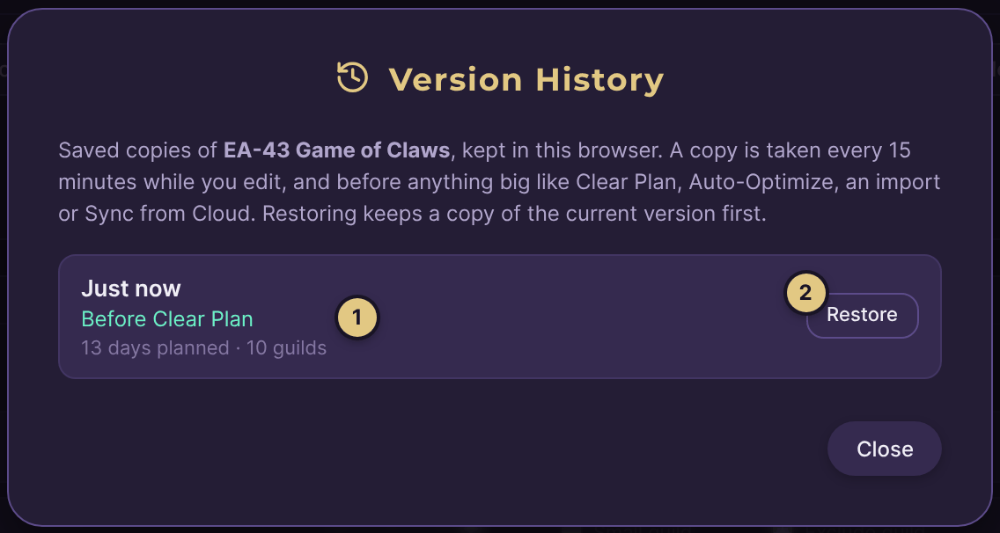

  1. **Why the copy was taken**, e.g. just before Clear Plan.
  2. **Restore** puts the server back to this copy.

- **Backups you can take elsewhere:** History stays in this browser only. Use **Export Server** for a file you can keep (drop it into **Import** to restore everything), or **Save to Cloud** to open the plan on another device.
- **Support:** found a problem or have an idea? Contact `arianes.` on Discord.
